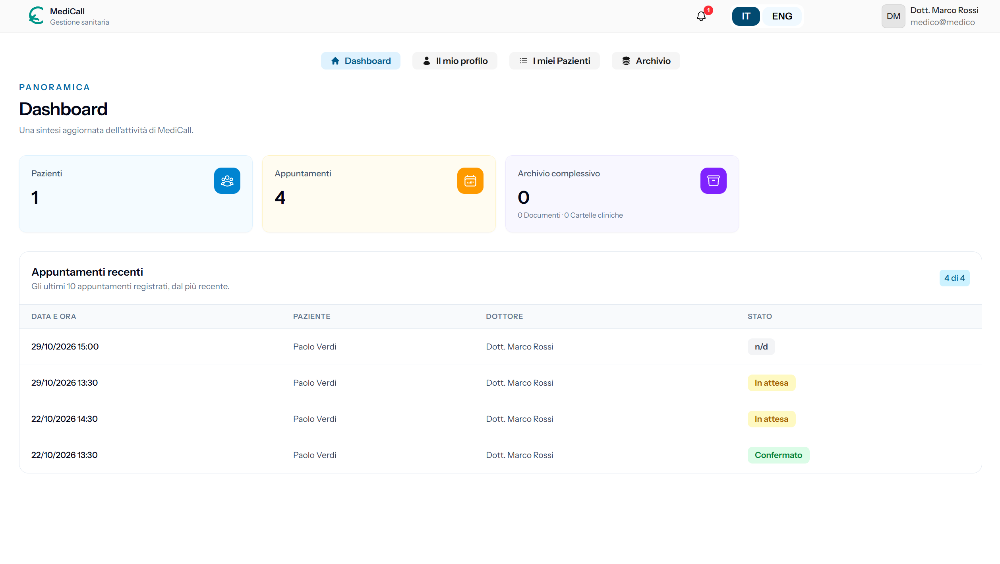

# MediCall

MediCall è una piattaforma web dedicata alla gestione sanitaria e alla programmazione delle visite mediche. L'applicazione è pensata per coordinare in modo semplice e centralizzato medici, pazienti e appuntamenti, migliorando la gestione delle cartelle cliniche, dei documenti e delle notifiche.

## Panoramica del progetto

Il progetto nasce come soluzione per semplificare la gestione della pratica medica in un unico ambiente digitale. Permette di:

- gestire utenti e profili sanitari;
- programmare e monitorare appuntamenti;
- consultare e aggiornare dati clinici e parametri sanitari;
- organizzare documenti medici;
- tenere traccia delle notifiche e delle comunicazioni tra medico e paziente;
- offrire una dashboard dedicata a ogni tipologia di utente.

## Funzionalità principali

- Dashboard per amministratori e utenti guest;
- registrazione e gestione dei medici;
- gestione dei pazienti e delle informazioni anagrafiche;
- prenotazione di visite con diversi tipi di appuntamento;
- monitoraggio di parametri e soglie sanitarie;
- gestione delle cartelle cliniche e documenti medici;
- sistemi di notifiche e aggiornamenti in tempo reale;
- supporto multi-ruolo con autorizzazioni specifiche.

## Stack tecnologico

- Laravel 13
- Livewire 4
- Fortify
- Spatie Laravel Permission
- Blade + Tailwind CSS
- Vite
- PHP 8.3+

## Struttura del progetto

- `app/` — logica applicativa, modelli, componenti Livewire e servizi;
- `config/` — configurazioni dell'applicazione;
- `database/` — migrazioni, factory e seeders;
- `resources/` — view Blade, asset frontend e componenti UI;
- `routes/` — definizione delle route web;
- `tests/` — test automatici feature;
- `public/` — asset pubblici e risorse statiche.

## Requisiti

Prima di iniziare, assicurati di avere installato:

- PHP 8.3 o superiore
- Composer
- Node.js e npm
- un database compatibile con Laravel (SQLite in locale, MySQL o PostgreSQL in produzione)

## Installazione

1. Clona il repository:

   ```bash
   git clone https://github.com/Salvo170586SP/MediCall.git
   cd MediCall
   ```

2. Installa le dipendenze PHP:

   ```bash
   composer install
   ```

3. Installa le dipendenze frontend:

   ```bash
   npm install
   ```

4. Copia il file delle variabili d'ambiente:

   ```bash
   cp .env.example .env
   ```

5. Genera la chiave dell'applicazione:

   ```bash
   php artisan key:generate
   ```

6. Esegui le migrazioni del database:

   ```bash
   php artisan migrate
   ```

7. Avvia l'applicazione in locale:

   ```bash
   composer run dev
   ```

Oppure, se preferisci avviare i servizi separatamente:

```bash
php artisan serve
npm run dev
```

## Sezione immagini

Di seguito alcune immagini del progetto e della sua interfaccia. 



 
## Licenza

Questo progetto è distribuito con licenza MIT. Consulta il file `LICENSE` se presente nel repository per i dettagli completi.

## Contatti

Per informazioni o eventuali modifiche, fare riferimento al repository del progetto o al team di sviluppo responsabile.
